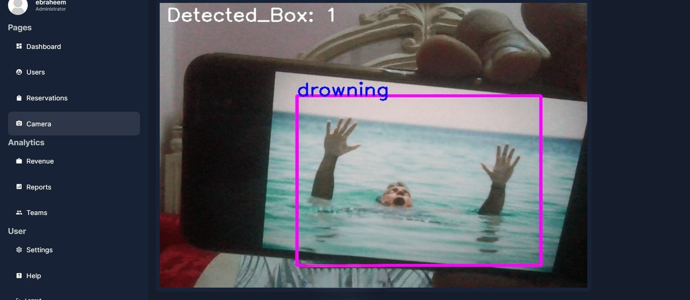
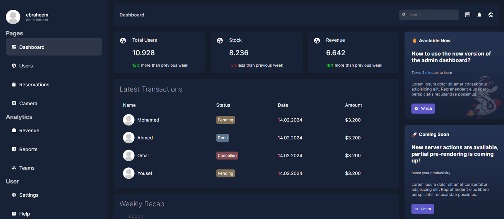
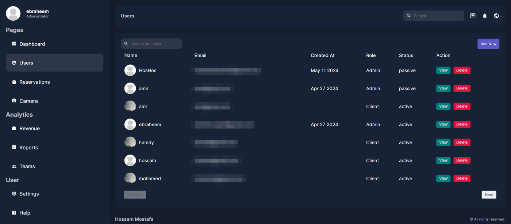
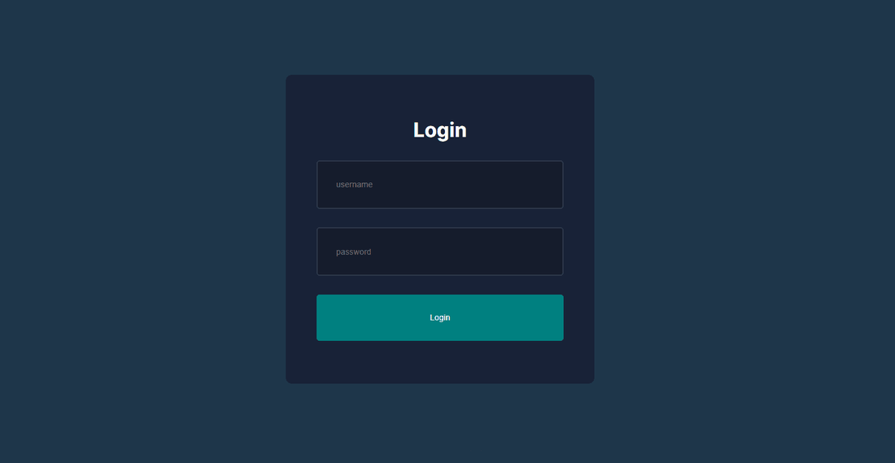
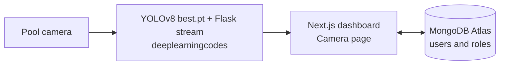

<div align="center">
# SMARTPOOL
 
**AI-based swimming pool monitoring dashboard**
 
Real-time drowning and abnormal-behavior detection with role-based alerts for lifeguards and facility admins.
 


 
🏆 **3rd place, Google DevFest Assiut**
 
</div>
## Overview
 
SMARTPOOL is a graduation project that combines computer vision with a web dashboard. A YOLOv8 model watches the pool camera feed and classifies what it sees as **drowning**, **swimming** or **person out of water**. The dashboard shows the annotated live camera next to the tools an administrator needs to manage users.
 
This repository contains the **dashboard** (Next.js). The detection service lives in a separate repository: **[deeplearningcodes](https://github.com/HosamMosstfa/deeplearningcodes)**.
 
## Features
 
- **Live camera page** with the YOLOv8 detection stream, bounding boxes, class labels and a detected-box counter
- **Three detection classes:** `drowning`, `swimming`, `person out of water`
- **Login** with credentials and role-based access (Administrator and Client roles)
- **User management:** search, add, view and delete users, with role and active/passive status, plus pagination
- **Dashboard overview** with summary cards and a sidebar layout
- **Route protection** with Next.js middleware
- **MongoDB** for application data
## Screenshots
 
<table>
  <tr>
    <td width="50%"><br /><sub><b>Camera:</b> live YOLOv8 detection</sub></td>
    <td width="50%"><br /><sub><b>Dashboard:</b> overview</sub></td>
  </tr>
  <tr>
    <td width="50%"><br /><sub><b>Users:</b> management table</sub></td>
    <td width="50%"><br /><sub><b>Login</b></sub></td>
  </tr>
</table>
## How it fits together
 

 
## Tech stack
 
| Layer | Technology |
| :-- | :-- |
| Dashboard | Next.js (App Router), React |
| Authentication | Auth.js-style credentials login, middleware route protection |
| Database | MongoDB (Atlas) |
| Detection | YOLOv8, Flask, Python (separate repo) |
 
## Getting started
 
> **Run the detection service first.** The dashboard's camera page depends on it. Follow the steps in [deeplearningcodes](https://github.com/HosamMosstfa/deeplearningcodes), then come back here.
 
### 1. Install
 
```bash
git clone https://github.com/HosamMosstfa/projectgraduation.git
cd projectgraduation
npm install
```
 
### 2. Configure environment variables
 
Copy the example file and fill in your own values:
 
```bash
cp .env.example .env
```
 
| Variable | Description |
| :-- | :-- |
| `MONGO` | Your MongoDB connection string. Create a free cluster on [MongoDB Atlas](https://www.mongodb.com/atlas) and use a dedicated database user. |
| `AUTH_SECRET` | A long random secret. Generate one with `openssl rand -base64 32` or `npx auth secret`. |
| `AUTH_URL` | The auth endpoint, `http://localhost:3000/api/auth` for local development. |
 
> Never commit your `.env` file. It is already listed in `.gitignore`.
 
### 3. Run
 
```bash
npm run dev
```
 
Open [http://localhost:3000](http://localhost:3000). The first page is the **login page**. Sign in with an account that exists in your database.
 
## Project structure
 
```
projectgraduation/
├── app/            Pages, layouts and API routes (Next.js App Router)
├── public/         Static assets
├── middleware.js   Auth and role-based route protection
├── next.config.js
└── package.json
```
 
## Troubleshooting
 
| Problem | Fix |
| :-- | :-- |
| Camera page is empty | Make sure the detection service from `deeplearningcodes` is running before you open the dashboard. |
| Cannot connect to the database | Check `MONGO`, and that your IP address is allowed in Atlas under Network Access. |
| Login redirect loop | Confirm `AUTH_SECRET` is set and `AUTH_URL` matches the address you opened in the browser. |
 
## Author
 
**Hossam Mostafa** · [LinkedIn](https://www.linkedin.com/in/hosammostfa) · [GitHub](https://github.com/HosamMosstfa) · hossammostafa6520@gmail.com
 
